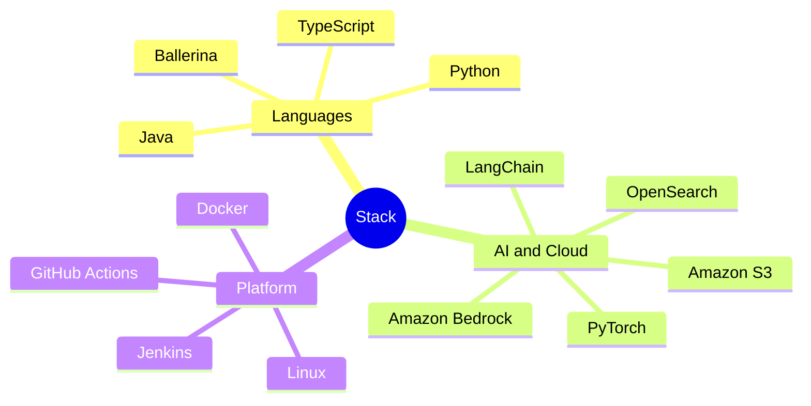

# Dasun Deshaja

 

 

## About

Computer Engineering undergraduate at the **University of Ruhuna**, and a Software Engineering
intern at **WSO2** building Ballerina AI integrations for AWS.

I work at the layer where AI meets infrastructure — model providers, vector stores, and the
plumbing that makes agents genuinely useful. Away from that, I spend my time on security and
networking.

## Currently

Shipping upstream into [`ballerina-platform`](https://github.com/ballerina-platform):

- A **Bedrock** model & embedding provider for Ballerina AI agents
- An `ai:VectorStore` for **Amazon OpenSearch** — managed domains and Serverless
- An AI `DataLoader` for **Amazon S3**, and agent memory backed by **Bedrock AgentCore**

## Stack

## Selected work

**[prng-lsb-steganography](https://github.com/SahanjithD/prng-lsb-steganography)** — PRNG-based adaptive
LSB image steganography with secret-key security, benchmarked against sequential LSB using PSNR,
histogram analysis and RS steganalysis.

**[malware-image-classification-cnn](https://github.com/SahanjithD/malware-image-classification-cnn)** —
Malware binaries rendered as grayscale images and classified across 25 families on the Malimg
dataset. PyTorch.

**[SDN_Test_Bed](https://github.com/SahanjithD/SDN_Test_Bed)** — Software-defined networking lab with
OpenFlow applications, including ML-powered DDoS detection.

**[Draftly](https://github.com/SahanjithD/Draftly)** — Open-source blogging platform on the MERN stack,
containerised with Docker and deployed to AWS through a Jenkins pipeline.

<picture>
  <source media="(prefers-color-scheme: dark)" srcset="https://raw.githubusercontent.com/SahanjithD/SahanjithD/output/github-snake-dark.svg" />
  <source media="(prefers-color-scheme: light)" srcset="https://raw.githubusercontent.com/SahanjithD/SahanjithD/output/github-snake.svg" />
  
</picture>

## Stats

<!-- stats:start -->
I joined GitHub **2** years ago and have since pushed **404** commits, opened **15** issues and
submitted **84** pull requests — **54** of them merged — across **19** personal projects and
**16** repositories.
<!-- stats:end -->
